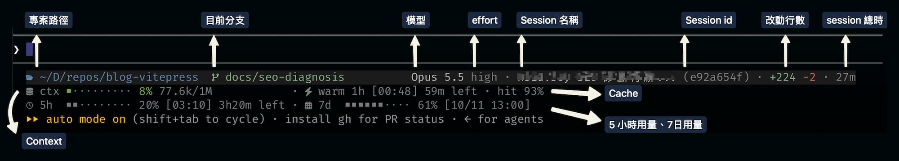

# Claude Code Status Line：賞心悅目地顯示 context、cache、用量

大概上個世紀前（誇張），Claude Code 推出了自訂 Status line 的功能，最近我突然覺得應該要來升級一下，因為原本使用的設定太簡陋，印象中只有顯示 session context 的樣子（早已忘記）。於是我開始反思我經常做哪些事情，並比對可以抓到的資料後（Claude Code 跟我討論非常多輪之後）完成了這一版。



原本想說只要顯示一行，結果發現會很擠又很醜，所以最後妥協變成三行。
現在用得非常喜歡，所以記錄一下順便自己回顧功能。

## 第一行

第一行有這些資訊：

- 目錄：目前目錄。$HOME 顯示為 ~，保留最後兩層完整名稱，其餘縮寫為首字母
- git branch：git branch 與狀態。⇡/⇣ 領先/落後 upstream，+ staged、! unstaged、? untracked、~ 衝突
- worktree：目前所在的 worktree 名稱（--worktree session 或 linked git worktree）；不在 worktree 時不顯示
- model、effort：目前 model 與 reasoning effort（model 不支援 effort 時只顯示 model）
- fast mode：已開啟 /fast；關閉時不顯示
- session 資訊：session 名稱與 session ID 前 8 碼；名稱超過 24 欄寬會截斷為 `...`
- 改動行數：此 session 由 Claude 新增 / 刪除的程式碼行數；都是 0 時不顯示
- session 經過時間：此 session 累計執行時間（跨 resume 累加，不含關閉期間）

反正就是基本資訊。

## 第二行：Context

分成以下兩個資訊：

- 圖像化的 context 使用率：context window 使用率，10 個節點、每格 10%
- token 數：目前佔用的 token 數 / context window 大小；佔用達 150k 時變黃（我覺得這個值應該要上修）

```
ctx ￭￭￭￭･･････ 42%  84.3k/200k
```

## 第二行：Cache

這次額外研究了 prompt cache 才知道（超晚才知道），每次送出 prompt 時，前面重複的 context 會從 cache 讀取，但 cache 有有效時間（5 分鐘或 1 小時），距離上次送出超過這段時間，cache 就會失效，下一次請求得重新寫入整段 context。

在 status line 上會看到兩種狀況：

1. `warm 1h [16:44] 23m left`
2. `cold · next +184.3k`

第一種狀況分別代表：cache 狀態（`warn`）、cache 有效時間（`1h`）、預計過期的時間點（`[16:44]`）與剩餘時間（`23m left`）

第二種狀況分別是：cache 已過期（`cold`），下一次請求需要重新處理的 token 數 （`next +184.3k`）

除了以上資訊之外，後面還會依據狀況額外顯示資訊：

- `hit 91%`：本 session 從 cache 讀取的 token 佔全部輸入的比例
- `miss 2 +150.2k (tools_changed +1)`：cache 意外失效的次數、因失效而重寫的 token 數，以及最近一次失效的推測原因；同時有多個原因時只顯示第一個，其餘以 +N 表示；沒有失效時不顯示

> **為什麼要看 cache miss**：失效時整個 prefix 都要重新寫入 cache，寫入的成本遠高於讀取，在訂閱方案下也會消耗 5h / 7d 額度。常見原因多半可以避免：
>
> - model_changed：session 中途切換 model
> - tools_changed：MCP server 連上或斷開，工具清單改變
> - system_prompt_changed：修改 CLAUDE.md、output style 等 system prompt 內容
> - messages_rewritten：對話歷史被改寫
> - ttl_expired_5m / ttl_expired_1h：閒置超過 cache 有效時間
> - likely_server_side / unknown：非本機造成，通常無法處理

這樣子的顯示資訊非常有幫助，除了增加焦慮感之外（?），也可以避免浪費寶貴的 token

## 第三行：rate limit

加上了 5 小時和 7 天的上限，因為我太常去看了，乾脆就直接顯示。

```
5h ￭￭････････ 23% [18:27] 1h12m left  7d ￭￭￭￭･･････ 41% [10/08 03:17]
```

- 5 小時用量、重置時間與距離重置的剩餘時間
- 7 天用量與重置日期時間（月/日）

> session 第一次 API 回應之後才會出現

## 抄作業

以下提供我的設定，反正不滿意就讓 Claude Code 來改也滿快的。

### 安裝

#### 需求

為了完整達到以上效果，需要安裝以下工具

- **jq**：解析 Claude Code 傳入的 JSON
- **perl**：計算含中文字的顯示寬度（macOS 內建）
- **git**：顯示 branch 狀態
- **Nerd Font**：顯示 icon，終端機字型需設為 Nerd Font
- **Claude Code v2.1.251 以上**：才有 `prompt_cache` 資料，舊版本 cache 欄位會顯示 `cache —`

```shell
brew install jq
brew install --cask font-fira-code-nerd-font
```

### 加入設定檔 `statusline-command.sh`

1. 新增 `~/.claude/statusline-command.sh` 檔案

```sh
#!/bin/bash
# Claude Code statusLine, styled after ~/.p10k.zsh (classic powerline preset).
#   Line 1: dir (p10k `dir`)  git (p10k `vcs`)  worktree   ...right-aligned: model effort fast · session · lines · time
#   Line 2: ctx bar % tokens · cache state · hit ratio · misses
#   Line 3: 5h bar % [reset] left · 7d bar % [reset]
# Needs jq, perl and git; icons need a Nerd Font.

# All fields in one jq call, joined by the unit separator (\x1f, non-whitespace so empty
# fields survive `read`); null -> "", newlines in strings -> spaces.
#   ctx_tokens: context occupancy of the latest request, input + cache writes + cache reads
#     (output excluded) — the same basis Claude Code uses for used_percentage.
#   c_miss_cause: first cause of the latest cache miss, "+N" when there are more.
IFS=$'\x1f' read -r cwd model ctx_pct ctx_size ctx_tokens effort fast_mode \
  session_id session_name duration_ms lines_added lines_removed worktree \
  rl_5h rl_5h_reset rl_7d rl_7d_reset \
  c_observed c_warm c_expires c_hit c_recache c_ttl c_misses c_miss_tokens c_miss_cause \
  <<< "$(jq -r '[
    (.workspace.current_dir // .cwd), .model.display_name,
    .context_window.used_percentage, .context_window.context_window_size,
    ((.context_window.current_usage | if . then .input_tokens + .cache_creation_input_tokens + .cache_read_input_tokens else null end) // .context_window.total_input_tokens),
    .effort.level, .fast_mode,
    .session_id, .session_name, .cost.total_duration_ms,
    .cost.total_lines_added, .cost.total_lines_removed,
    (.worktree.name // .workspace.git_worktree),
    .rate_limits.five_hour.used_percentage, .rate_limits.five_hour.resets_at,
    .rate_limits.seven_day.used_percentage, .rate_limits.seven_day.resets_at,
    (.prompt_cache // {} | .caching_observed, .warm, .expires_at, .hit_ratio, .recache_tokens_if_cold,
      .ttl, .misses, .miss_recache_tokens,
      ((.last_miss_cause.causes // []) | if length == 0 then null elif length == 1 then .[0] else "\(.[0]) +\(length - 1)" end))
  ] | map(if . == null then "" else tostring | gsub("[\n\u001f]"; " ") end) | join("\u001f")')"
now=$(date +%s)

# --- colors ---
RESET="\033[0m"
# Dir, vcs and model text use desaturated takes on p10k's hues.
DIR_FG="\033[38;5;67m"          # muted blue   #5f87af (p10k dir 31)
VCS_CLEAN_FG="\033[38;5;108m"   # muted green  #87af87 (p10k clean 76)
VCS_DIRTY_FG="\033[38;5;180m"   # muted yellow #d7af87 (p10k modified 178)
VCS_CONFLICT_FG="\033[38;5;167m" # muted red   #d75f5f (p10k conflicted 196)
WORKTREE_FG="\033[38;5;139m"    # muted purple #af87af
MODEL_FG="\033[38;5;250m"       # light grey
EFFORT_FG="\033[38;5;244m"      # mid grey, a step softer than the model
FAST_FG="\033[38;5;173m"        # muted orange #d7875f
LINES_ADD_FG="\033[38;5;108m"   # muted green, as VCS_CLEAN_FG
LINES_DEL_FG="\033[38;5;167m"   # muted red, as VCS_CONFLICT_FG
META_FG="\033[2;90m"       # meta = grey (246)
LINE1_BG="\033[48;5;234m"   # first-row band: faint dark grey (234, #1c1c1c)
USAGE_OK_FG="\033[2;32m"     # <70% = green
USAGE_WARN_FG="\033[2;33m"   # 70-89% = yellow
USAGE_HOT_FG="\033[2;31m"    # >=90% = red

# --- layout ---
SESSION_NAME_MAX=24  # columns before a session name is cut to "..."
RIGHT_MARGIN=6       # columns kept free at the right edge of line 1 (2 clipped the end)
CTX_GUARD_TOKENS="${CLAUDE_CTX_GUARD_TOKENS:-150000}"  # ctx tokens turn yellow at this count

# --- Nerd Font icons (Font Awesome range, present in Nerd Fonts v2 and v3) ---
ICON_DIR=$'\xef\x81\xbc'     # U+F07C folder-open
ICON_CTX=$'\xef\x87\x80'     # U+F1C0 database
ICON_WARM=$'\xef\x83\xa7'    # U+F0E7 bolt
ICON_COLD=$'\xef\x8b\x9c'    # U+F2DC snowflake
ICON_5H=$'\xef\x80\x97'      # U+F017 clock
ICON_7D=$'\xef\x81\xb3'      # U+F073 calendar
ICON_WORKTREE=$'\xef\x84\xa6' # U+F126 code-fork
ICON_FAST=$'\xef\x84\xb5'     # U+F135 rocket

# Formats milliseconds as a short duration: 45s, 23m, 1h05m.
fmt_duration() {
  local s=$(( $1 / 1000 ))
  if [ "$s" -ge 3600 ]; then
    printf "%dh%02dm" $(( s / 3600 )) $(( s % 3600 / 60 ))
  elif [ "$s" -ge 60 ]; then
    printf "%dm" $(( s / 60 ))
  else
    printf "%ds" "$s"
  fi
}

# Formats a token count compactly: 950 -> 950, 84321 -> 84.3k, 200000 -> 200k, 1000000 -> 1M.
fmt_tokens() {
  awk -v n="$1" 'BEGIN {
    if (n >= 1000000) { s = sprintf("%.1f", n / 1000000); u = "M" }
    else if (n >= 1000) { s = sprintf("%.1f", n / 1000); u = "k" }
    else { s = sprintf("%d", n); u = "" }
    sub(/\.0$/, "", s)
    print s u
  }'
}

# Echoes the threshold color for a plain integer percentage; $2 overrides the <70% color.
usage_color() {
  local pct="$1" ok="${2:-$USAGE_OK_FG}"
  if [ "$pct" -ge 90 ] 2>/dev/null; then
    echo "$USAGE_HOT_FG"
  elif [ "$pct" -ge 70 ] 2>/dev/null; then
    echo "$USAGE_WARN_FG"
  else
    echo "$ok"
  fi
}

# Builds a threshold-colored "pct%" value; pct must be a plain integer, $2 as in usage_color.
usage_value() {
  printf "%b" "$(usage_color "$1" "$2")${1}%${RESET}"
}

# Builds a node progress bar (￭ filled / ･ empty) of $2 nodes (default 10),
# rounded to the nearest node; filled nodes are threshold-colored ($3 as usage_color's $2), empty ones grey.
# pct must be a plain integer.
usage_bar() {
  local pct="$1" width="${2:-10}" ok="$3" filled empty i
  filled=$(( (pct * width + 50) / 100 ))
  [ "$filled" -gt "$width" ] && filled="$width"
  empty=$(( width - filled ))
  local on="" off=""
  for ((i = 0; i < filled; i++)); do on="${on}￭"; done
  for ((i = 0; i < empty; i++)); do off="${off}･"; done
  printf "%b" "$(usage_color "$pct" "$ok")${on}${META_FG}${off}${RESET}"
}

# Formats epoch seconds as local HH:MM (BSD date, then GNU date fallback).
# $2 overrides the format (default %H:%M).
fmt_clock() {
  local fmt="${2:-%H:%M}"
  date -r "$1" "+$fmt" 2>/dev/null || date -d "@$1" "+$fmt"
}

# Prints the on-screen width of a segment: escape codes stripped, East Asian
# wide/fullwidth characters (e.g. CJK) counted as 2 columns, everything else as 1.
vis_width() {
  printf "%b" "$1" | perl -CS -0777 -ne 's/\e\[[0-9;]*m//g; my $w = 0; $w += /\p{Ea=W}|\p{Ea=F}/ ? 2 : 1 for split //; print $w'
}

# Truncates plain text $1 to at most $2 columns, ending in "..." when cut.
truncate_text() {
  perl -CSA -e 'my ($s, $max) = @ARGV;
    my $cw = sub { $_[0] =~ /\p{Ea=W}|\p{Ea=F}/ ? 2 : 1 };
    my $w = 0; $w += $cw->($_) for split //, $s;
    if ($w <= $max) { print $s; exit }
    my ($out, $used) = ("", 0);
    for (split //, $s) { last if $used + $cw->($_) > $max - 3; $out .= $_; $used += $cw->($_) }
    print "$out..."' "$1" "$2"
}

# Right-pads a segment with spaces to on-screen width $2.
pad_to() {
  local w
  w=$(vis_width "$1")
  printf "%s%*s" "$1" $(( $2 > w ? $2 - w : 0 )) ""
}

# --- dir segment ---
# Mimic p10k: replace $HOME with ~, keep last 2 dirs in full (anchors),
# shorten the rest to their first character (truncate_to_unique-ish).
display_dir="${cwd/#$HOME/~}"
IFS='/' read -r -a parts <<< "$display_dir"
n=${#parts[@]}
short_dir=""
for i in "${!parts[@]}"; do
  part="${parts[$i]}"
  [ -z "$part" ] && continue
  # Keep the last 2 non-empty segments in full; shorten earlier ones.
  remaining=$(( n - i - 1 ))
  if [ "$remaining" -lt 2 ] || [ "$part" = "~" ]; then
    seg="$part"
  else
    seg="${part:0:1}"
  fi
  if [ -z "$short_dir" ]; then
    short_dir="$seg"
  else
    short_dir="$short_dir/$seg"
  fi
done
[ "${display_dir:0:1}" = "/" ] && short_dir="/$short_dir"

dir_out="${DIR_FG}${ICON_DIR} ${short_dir}${RESET}"

# --- vcs (git) segment, mirroring my_git_formatter() in p10k.zsh ---
# One `git status` call (porcelain v2 + branch header) counted by awk, so large repos with many
# changed files don't pay for several git processes plus a per-line bash loop. Without -u it
# honors the repo's status.showUntrackedFiles; set it to "no" in a repo where scanning is slow.
# Prints "head oid ahead behind staged unstaged untracked conflicted"; nothing outside a repo.
git_out=""
git_info=$(git -C "$cwd" --no-optional-locks status --porcelain=v2 --branch 2>/dev/null | awk '
  /^# branch\.oid / { oid = $3 }
  /^# branch\.head / { head = $3 }
  /^# branch\.ab / { ahead = substr($3, 2); behind = substr($4, 2) }
  /^[12] / { if (substr($2, 1, 1) != ".") staged++; if (substr($2, 2, 1) != ".") unstaged++ }
  /^u / { conflicted++ }
  /^\? / { untracked++ }
  END { if (head != "") printf "%s %s %d %d %d %d %d %d\n", head, oid, ahead, behind, staged, unstaged, untracked, conflicted }')
if [ -n "$git_info" ]; then
  read -r branch oid ahead behind staged unstaged untracked conflicted <<< "$git_info"
  [ "$branch" = "(detached)" ] && branch="@${oid:0:7}"

  # Text color follows repo state: red if conflicted, yellow if dirty, else green.
  if [ "$conflicted" -gt 0 ]; then
    vcs_fg="$VCS_CONFLICT_FG"
  elif [ "$staged" -gt 0 ] || [ "$unstaged" -gt 0 ]; then
    vcs_fg="$VCS_DIRTY_FG"
  else
    vcs_fg="$VCS_CLEAN_FG"
  fi

  git_out="${vcs_fg} ${branch}"  # counters share the branch color
  [ "$ahead" -gt 0 ] && git_out="${git_out} ⇡${ahead}"
  [ "$behind" -gt 0 ] && git_out="${git_out} ⇣${behind}"
  [ "$conflicted" -gt 0 ] && git_out="${git_out} ~${conflicted}"
  [ "$staged" -gt 0 ] && git_out="${git_out} +${staged}"
  [ "$unstaged" -gt 0 ] && git_out="${git_out} !${unstaged}"
  [ "$untracked" -gt 0 ] && git_out="${git_out} ?${untracked}"
  git_out="${git_out}${RESET}"
fi

worktree_out=""
[ -n "$worktree" ] && worktree_out="${WORKTREE_FG}${ICON_WORKTREE} ${worktree}${RESET}"

# Joins the arguments with a grey " · " separator.
join_segs() {
  local out="" seg
  for seg in "$@"; do
    [ -n "$out" ] && out="${out} ${META_FG}·${RESET} "
    out="${out}${seg}"
  done
  printf "%b" "$out"
}

# Labels stay plain (META_FG); only the numeric values are threshold-colored.
ctx_segs=()
# Token count "used/size", shown with or without a percentage; used is 0 until known.
# Used turns yellow at CTX_GUARD_TOKENS; the percentage colors track window fullness instead.
ctx_used_fg="$META_FG"
[ "${ctx_tokens:-0}" -ge "$CTX_GUARD_TOKENS" ] 2>/dev/null && ctx_used_fg="$USAGE_WARN_FG"
ctx_extra=" ${ctx_used_fg}$(fmt_tokens "${ctx_tokens:-0}")${RESET}"
[ -n "$ctx_size" ] && ctx_extra="${ctx_extra}${META_FG}/$(fmt_tokens "$ctx_size")${RESET}"
if [ -n "$ctx_pct" ]; then
  pct="${ctx_pct%.*}"
  ctx_segs+=("${META_FG}${ICON_CTX} ctx${RESET} $(usage_bar "$pct") $(usage_value "$pct")${ctx_extra}")
else
  # No percentage yet (fresh session, or just after /compact): empty bar + grey "—".
  ctx_segs+=("${META_FG}${ICON_CTX} ctx $(usage_bar 0 10 "$META_FG")${META_FG} —${RESET}${ctx_extra}")
fi

# Cache segment: warm -> TTL, clock time it goes cold plus time left (grey, yellow within 5m); cold ->
# tokens the next request must re-process; no data yet / caching not observed -> grey "cache —".
# Unexpected misses add a yellow "miss N +tokens (first cause +more)"; hidden while there are none.
if [ "$c_observed" != "true" ]; then
  ctx_segs+=("${META_FG}${ICON_WARM} cache —${RESET}")
else
  hit=""
  [ -n "$c_hit" ] && hit=" ${META_FG}· hit $(awk -v r="$c_hit" 'BEGIN { printf "%d", r * 100 + 0.5 }')%${RESET}"
  if [ "${c_misses:-0}" -gt 0 ] 2>/dev/null; then
    miss="miss ${c_misses}"
    [ "${c_miss_tokens:-0}" -gt 0 ] 2>/dev/null && miss="${miss} +$(fmt_tokens "$c_miss_tokens")"
    [ -n "$c_miss_cause" ] && miss="${miss} (${c_miss_cause})"
    hit="${hit} ${META_FG}·${RESET} ${USAGE_WARN_FG}${miss}${RESET}"
  fi
  if [ "$c_warm" = "true" ] && [ -n "$c_expires" ]; then
    left=$(( c_expires - now ))
    [ "$left" -lt 0 ] && left=0
    color="$META_FG"
    [ "$left" -le 300 ] && color="$USAGE_WARN_FG"
    ttl=""
    [ -n "$c_ttl" ] && ttl=" ${c_ttl}"
    ctx_segs+=("${color}${ICON_WARM} warm${ttl} [$(fmt_clock "$c_expires")] $(fmt_duration $(( left * 1000 ))) left${RESET}${hit}")
  else
    cold="cold"
    [ -n "$c_recache" ] && cold="cold · next +$(fmt_tokens "$c_recache")"
    ctx_segs+=("${USAGE_HOT_FG}${ICON_COLD} ${cold}${RESET}${hit}")
  fi
fi

model_out=""
if [ -n "$model" ]; then
  model_out="${MODEL_FG}${model}${RESET}"
  [ -n "$effort" ] && model_out="${model_out} ${EFFORT_FG}${effort}${RESET}"
  [ "$fast_mode" = "true" ] && model_out="${model_out} ${FAST_FG}${ICON_FAST} fast${RESET}"
fi

# Session info after the model: name (short id) · lines changed · elapsed time.
info_segs=()
[ -n "$model_out" ] && info_segs+=("$model_out")
if [ -n "$session_id" ] || [ -n "$session_name" ]; then
  # Names are capped at SESSION_NAME_MAX columns so line 1 stays on one row.
  [ -n "$session_name" ] && session_name="$(truncate_text "$session_name" "$SESSION_NAME_MAX")"
  session_label="${session_name:-${session_id:0:8}}"
  [ -n "$session_name" ] && [ -n "$session_id" ] && session_label="${session_name} ${META_FG}(${session_id:0:8})"
  info_segs+=("${MODEL_FG}${session_label}${RESET}")
fi
if [ "${lines_added:-0}" -gt 0 ] || [ "${lines_removed:-0}" -gt 0 ]; then
  info_segs+=("${LINES_ADD_FG}+${lines_added:-0}${RESET} ${LINES_DEL_FG}−${lines_removed:-0}${RESET}")
fi
[ -n "$duration_ms" ] && info_segs+=("${META_FG}$(fmt_duration "${duration_ms%.*}")${RESET}")

# Rate limits, each followed by its reset time in brackets (5h also with time left). Labels are padded to
# ctx's width ("5h " / "7d ") so the bars line up with the ctx bar.
limit_segs=()
if [ -n "$rl_5h" ]; then
  pct="${rl_5h%.*}"
  seg="${META_FG}${ICON_5H} 5h ${RESET} $(usage_bar "$pct" 10 "$META_FG") $(usage_value "$pct" "$META_FG")"
  if [ -n "$rl_5h_reset" ]; then
    left=$(( rl_5h_reset - now ))
    [ "$left" -lt 0 ] && left=0
    seg="${seg} ${META_FG}[$(fmt_clock "$rl_5h_reset")] $(fmt_duration $(( left * 1000 ))) left${RESET}"
  fi
  limit_segs+=("$seg")
fi
if [ -n "$rl_7d" ]; then
  pct="${rl_7d%.*}"
  seg="${META_FG}${ICON_7D} 7d ${RESET} $(usage_bar "$pct" 10 "$META_FG") $(usage_value "$pct" "$META_FG")"
  [ -n "$rl_7d_reset" ] && seg="${seg} ${META_FG}[$(fmt_clock "$rl_7d_reset" "%m/%d %H:%M")]${RESET}"
  limit_segs+=("$seg")
fi

# Align lines 2 and 3 as columns: pad the first item of each to the wider one,
# so the "·" separators and the second items (cache / 7d) start in the same column.
if [ "${#ctx_segs[@]}" -gt 0 ] && [ "${#limit_segs[@]}" -gt 1 ]; then
  w1=$(vis_width "${ctx_segs[0]}")
  w2=$(vis_width "${limit_segs[0]}")
  col=$(( w1 > w2 ? w1 : w2 ))
  ctx_segs[0]="$(pad_to "${ctx_segs[0]}" "$col")"
  limit_segs[0]="$(pad_to "${limit_segs[0]}" "$col")"
fi

# Line 1: dir  vcs  worktree on the left, model · session · lines · time right-aligned.
# Line 2: ctx · cache. Line 3: 5h · 7d.
# COLUMNS is set by Claude Code to the terminal width; RIGHT_MARGIN leaves room for
# the status row's own padding. Too narrow (or COLUMNS unset) -> two spaces instead.
line1="$dir_out"
[ -n "$git_out" ] && line1="${line1}  ${git_out}"
[ -n "$worktree_out" ] && line1="${line1}  ${worktree_out}"
if [ "${#info_segs[@]}" -gt 0 ]; then
  right="$(join_segs "${info_segs[@]}")"
  gap=2
  if [ -n "$COLUMNS" ] && [ "$COLUMNS" -gt 0 ] 2>/dev/null; then
    room=$(( COLUMNS - RIGHT_MARGIN - $(vis_width "$line1") - $(vis_width "$right") ))
    [ "$room" -gt "$gap" ] && gap="$room"
  fi
  line1="${line1}$(printf "%*s" "$gap" "")${right}"
fi
# Shade the whole first row (padding included) as a band. Render it first so
# every reset is a real escape, then re-apply the background after each one.
# Unquoted assignment on purpose: a quoted replacement keeps literal "" in some bash versions.
line1="$(printf "%b" "${LINE1_BG}${line1}${RESET}")"
esc_reset="$(printf "%b" "$RESET")"
esc_bg="$(printf "%b" "$LINE1_BG")"
line1=${line1//"$esc_reset"/$esc_reset$esc_bg}
printf "%s%b\n" "$line1" "$RESET"
[ "${#ctx_segs[@]}" -gt 0 ] && printf "%b\n" "$(join_segs "${ctx_segs[@]}")"
[ "${#limit_segs[@]}" -gt 0 ] && printf "%b\n" "$(join_segs "${limit_segs[@]}")"

```

2. `~/.claude/settings.json` 加入設定檔

```json
{
    "statusLine": {
        "type": "command",
        "command": "bash ~/.claude/statusline-command.sh",
        "refreshInterval": 10
    }
}
```

> `refreshInterval` 為 10 秒，讓 cache 過期時間與經過時間在閒置時也會更新。

腳本開頭的常數可以直接調整：

| 常數                              | 預設值     | 說明                                                                |
| --------------------------------- | ---------- | ------------------------------------------------------------------- |
| `SESSION_NAME_MAX`                | `24`       | session 名稱最大欄寬，超過以 `...` 截斷                             |
| `RIGHT_MARGIN`                    | `6`        | 第一行右側保留的欄數；最右邊的文字被切掉時調大                      |
| `CTX_GUARD_TOKENS`                | `150000`   | ctx token 數變黃的門檻                                              |
| `LINE1_BG`                        | `48;5;234` | 第一行底色（256 色），數字越小越暗                                  |
| `DIR_FG`、`VCS_*_FG`、`MODEL_FG`… | 略         | 各項目文字顏色                                                      |
| `ICON_*`                          | 略         | Nerd Font icon（使用 Font Awesome 區段，Nerd Fonts v2 / v3 皆支援） |

## 已知問題

- **icon 顯示為空白或方框**：代表終端機字型不是 Nerd Font。
